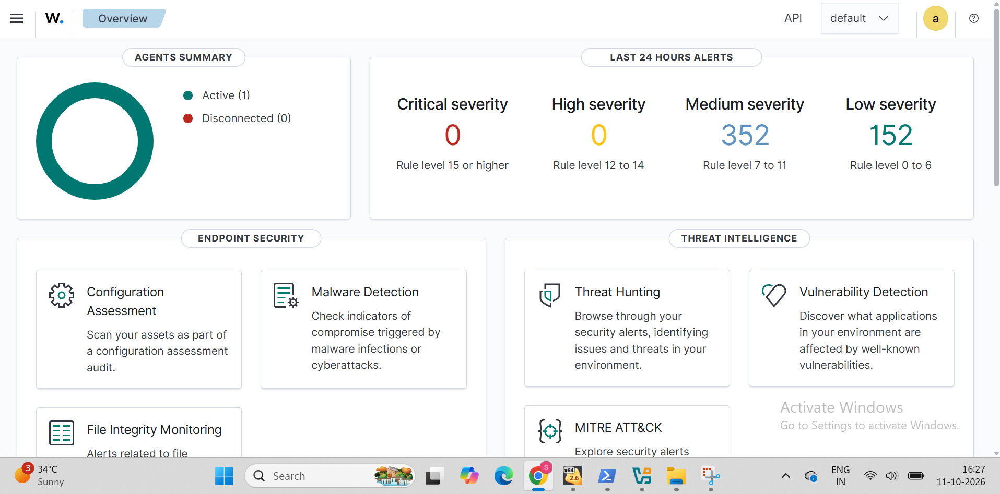
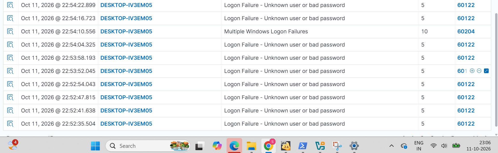
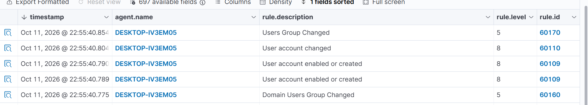

# Wazuh SIEM Home Lab — Brute Force & Persistence Detection

## Overview
A hands-on home lab built to understand how a SIEM detects and correlates
multi-stage attacks. Using Wazuh, I simulated a brute-force login attempt
followed by local account creation and privilege escalation on a Windows
endpoint, then investigated the resulting alerts as a SOC analyst would.

## Lab Setup
- **SIEM:** Wazuh (server + dashboard), deployed via official OVA on VirtualBox
- **Monitored endpoint:** Windows 10/11 (DESKTOP-IV3EM05), Wazuh agent installed and active
- **Logging:** Windows Security audit logging enabled via:
  ```
  auditpol /set /subcategory:"Logon" /success:enable /failure:enable
  ```
- **Network:** Single bridged/host-only network, all systems under my control
  
- 

## Attack Simulation

### Stage 1 — Brute Force (Failed Logons)
Manually and programmatically triggered repeated failed authentication
attempts against the Windows endpoint (lock-screen wrong password entries)
to simulate a brute-force login attempt.

**MITRE ATT&CK:** T1110 — Brute Force

### Stage 2 — Account Creation & Privilege Escalation
Simulated a post-compromise persistence technique by creating a new local
account and adding it to the Administrators group:
```powershell
net user hacker_test Passw0rd123! /add
net localgroup administrators hacker_test /add
```

**MITRE ATT&CK:** T1136 — Create Account, T1078 — Valid Accounts

## Detection Results

### Attack Chain Timeline

| Time (UTC)        | Event                                   | Rule ID      | Level |
|--------------------|------------------------------------------|--------------|-------|
| 22:52:29–22:54:10 | Repeated failed logon attempts           | 60122        | 5     |
| 22:54:10           | Correlated brute-force pattern detected  | 60204        | 10    |
| 22:55:40           | Local account created/enabled            | 60109        | 8     |
| 22:55:40           | Account attributes changed               | 60110        | 8     |
| 22:55:40           | Added to local Administrators group      | 60170        | 5     |
| 22:55:40           | Domain Users group changed               | 60160        | 5     |

### Screenshots

### Logon failure alert



### Correlated brute-force alert


### Commands


### Account creation alert



### Group change alert


## Analyst Notes

A single failed-logon event (rule 60122, level 5) is low-priority noise —
most likely a user mistyping a password. The value of the SIEM is in
**correlation**: after enough 60122 events occurred within a short window,
Wazuh escalated this into rule 60204 (level 10), flagging a likely
brute-force attempt rather than a one-off mistake.

Approximately 90 seconds after the brute-force pattern was detected, a new
local account was created and immediately added to the Administrators
group. Viewed together, this timeline reconstructs a plausible attack
narrative:

**Failed login attempts → successful compromise (implied) → persistence
via new admin account → privilege escalation**

In a real SOC, this sequence would be treated as a high-confidence
incident rather than isolated alerts, since the account-creation events
occurring so soon after a brute-force pattern is a strong indicator of
an attacker establishing persistent access.

**Verdict:** True positive (intentional test).

**Remediation performed:** Deleted the unauthorized account immediately
after verification:
```powershell
net user hacker_test /delete
```

## What I'd Check in a Real Incident
- Source IP/host of the failed logon attempts (local test here, but would
  pivot to network logs in production)
- Whether the brute-forced account had a successful logon immediately
  after the failures
- Account lockout policy status on the endpoint
- Whether `hacker_test` or similar accounts exist elsewhere in the
  environment (lateral movement check)
- Who/what process created the account (parent process, logged-in user
  context)

## Next Steps
- Add a Linux agent and repeat the brute-force test over SSH for
  cross-platform comparison
- Enable Wazuh active response (`firewall-drop`) to automatically block
  the source after N failed attempts
- Forward the same logs to Splunk and rebuild these detections using SPL
- Add Sysmon for deeper process-level visibility (parent/child process
  trees, command-line logging)

## Tools Used
Wazuh, VirtualBox, Windows Event Logs (Security), PowerShell
